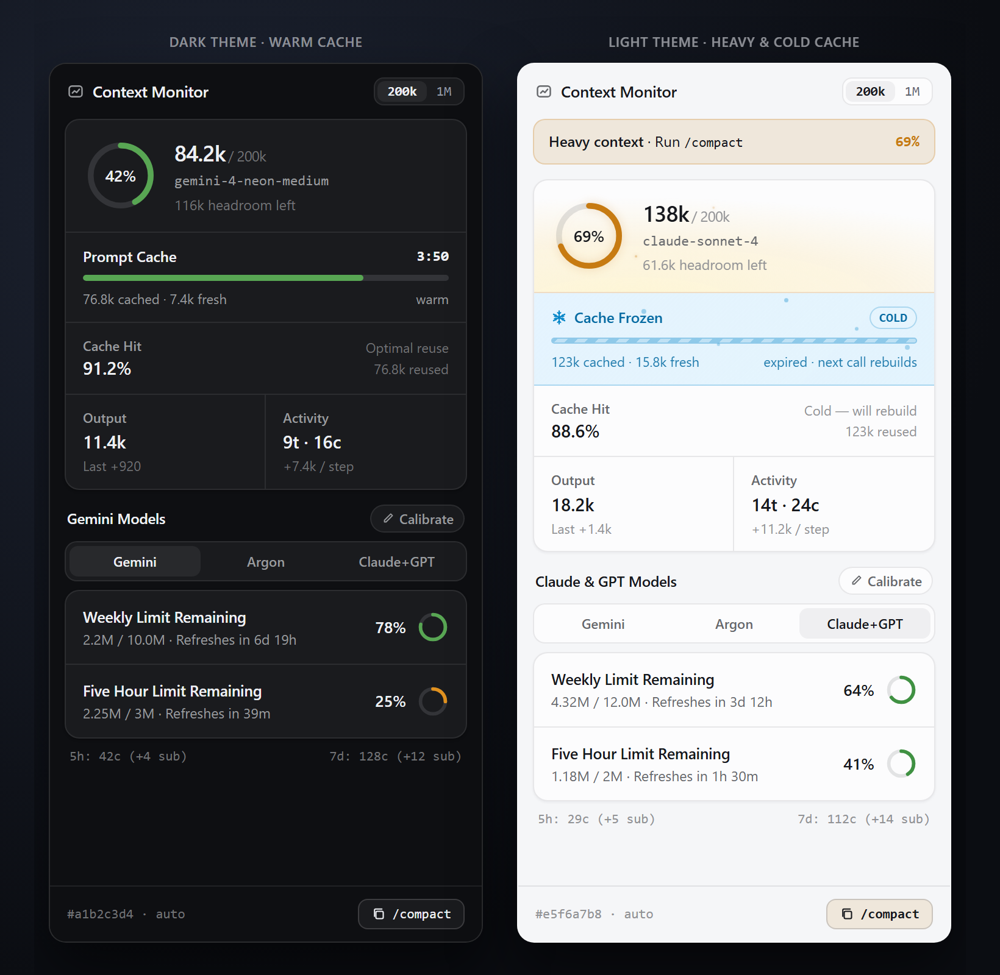

# Context Monitor for Antigravity

A lightweight, zero-dependency Antigravity plugin that adds a native-styled live side-pane HUD for tracking **context window usage**, **prompt cache warmth**, and **rolling 5-hour & weekly quota pools** across all local conversations and subagents.

<p align="center">
  
</p>

## Features

- **Live Context Window Gauge:** Real-time token count, headroom remaining, `200k` / `1M` switcher, and ambient visual states when context grows heavy (`>= 120k`) or critical (`>= 160k`).
- **Prompt Cache Warmth:** Live 5-minute TTL countdown bar with cached vs. fresh token breakdown and a frozen cold-cache indicator once expired.
- **Usage Limits (Antigravity Settings Style):** Tracks fixed-epoch **Weekly** and **5-Hour** remaining quota rings across Antigravity's three independent pools:
  - **Gemini Models** (Weekly + 5-Hour)
  - **Gemini 4 Argon** (Weekly)
  - **Claude & GPT Models** (Weekly + 5-Hour)
- **Sync from Settings Calibration:** Click **Calibrate** (or **Sync %**) to enter your actual remaining percentages (and optional reset countdowns) directly from Antigravity Settings — automatically solving each pool's ceiling and pinning your reset clock locally in `localStorage`. Manual token-ceiling entry is also available.
- **One-Click `/compact`:** Quick copy button in the footer that highlights when context crosses the warning threshold.
- **High-Context Chat Hook & Skill:** Alerts when context crosses `120k` tokens and includes the `context-usage` skill for on-demand token breakdowns.
- **Privacy-First & Cross-Platform:** 100% local Node.js (Windows, macOS, Linux), zero npm dependencies, zero external CDNs or telemetry, binds strictly to `127.0.0.1`, and reads only your local Antigravity `transcript.jsonl` files.

---

## Installation

### Option 1: Ask Antigravity (Easiest)

Paste this directly into an Antigravity chat:

```text
Install the Antigravity plugin from https://github.com/StarKly1/antigravity-context-monitor into ~/.gemini/config/plugins/context-monitor and enable it
```

### Option 2: Antigravity CLI

```bash
agy plugin install https://github.com/StarKly1/antigravity-context-monitor
```

### Option 3: Git Clone

**Windows (PowerShell):**
```powershell
git clone https://github.com/StarKly1/antigravity-context-monitor.git "$env:USERPROFILE\.gemini\config\plugins\context-monitor"
```

**macOS / Linux:**
```bash
git clone https://github.com/StarKly1/antigravity-context-monitor.git ~/.gemini/config/plugins/context-monitor
```

### Option 4: Manual ZIP

Download and extract the repository into `~/.gemini/config/plugins/context-monitor` (on Windows: `%USERPROFILE%\.gemini\config\plugins\context-monitor`).

After installing, enable **context-monitor** in **Customizations → Installed** (or restart Antigravity) and open **Context Monitor** in the right auxiliary side pane.

---

## Calibrating Quota Limits

Because Antigravity does not expose server-side quota ceilings or reset clocks to local plugins, the Usage Limits rings estimate remaining quota from your local transcripts. On first install, if your existing local usage exceeds the rough starter defaults, the HUD shows `—` with a **Sync %** button instead of a false `0%`:

1. Open Antigravity **Settings** to check your actual remaining percentages (and optionally the `"Refreshes in"` timers).
2. In **Context Monitor**, select a pool tab (`Gemini`, `Argon`, or `Claude+GPT`) and click **Sync %** / **Calibrate**.
3. Enter your **Weekly left (%)** and **5-Hour left (%)** (plus optional **Resets in**, e.g. `5d 12h` or `2h 30m`) and click **Save**.
   - Context Monitor automatically pins your cycle reset clock, recounts tokens inside the active cycle, and solves your plan tier's token ceiling (or sets a cycle-scoped baseline if prior usage happened on another machine).
   - Switch to the **Manual** tab in the drawer at any time to edit raw ceilings in millions of tokens directly.

---

## Plugin Structure

```text
context-monitor/
├── plugin.json                   # Plugin manifest
├── hooks.json                    # High-context warning hook (>120k)
├── scripts/
│   └── context_status.mjs        # Cross-platform hook & CLI metrics script
├── sidecars/
│   └── hud/
│       ├── sidecar.json          # Auxiliary side-pane sidecar manifest
│       ├── server.mjs            # Local HTTP server (127.0.0.1) & aggregator
│       └── ui.html               # Self-contained HUD frontend
└── skills/
    └── context-usage/
        └── SKILL.md              # On-demand context breakdown skill
```

## License

[MIT](LICENSE)
